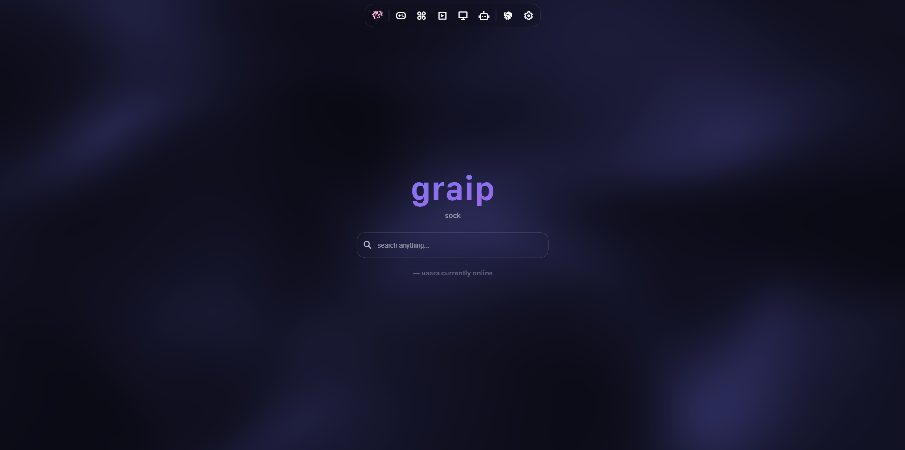

<div align="center">

<h1>
  <a href="https://github.com/debug-cli/graip"></a>
</h1>

<p>
  A static, deploy-anywhere web proxy and game site: 700+ games, a real multi-tab proxy browser,
  a movie browser, a panic key, and a debug log you can hand to a maintainer.
</p>

<p align="center">
  
</p>

<p align="center">
  <a href="https://github.com/debug-cli/graip/stargazers"><picture><source media="(prefers-color-scheme: dark)" srcset="https://www.shieldcn.dev/github/stars/debug-cli/graip.svg?variant=secondary&amp;size=sm&amp;mode=dark&amp;theme=purple&amp;font=jetbrains-mono"></picture></a>
  <a href="https://github.com/debug-cli/graip/network/members"><picture><source media="(prefers-color-scheme: dark)" srcset="https://www.shieldcn.dev/github/forks/debug-cli/graip.svg?variant=secondary&amp;size=sm&amp;mode=dark&amp;theme=purple&amp;font=jetbrains-mono"></picture></a>
  <a href="https://github.com/debug-cli/graip/watchers"><picture><source media="(prefers-color-scheme: dark)" srcset="https://www.shieldcn.dev/github/watchers/debug-cli/graip.svg?variant=secondary&amp;size=sm&amp;mode=dark&amp;theme=purple&amp;font=jetbrains-mono"></picture></a>
  <a href="https://github.com/debug-cli/graip/branches"><picture><source media="(prefers-color-scheme: dark)" srcset="https://www.shieldcn.dev/github/branches/debug-cli/graip.svg?variant=ghost&amp;size=sm&amp;mode=dark&amp;theme=purple&amp;font=jetbrains-mono"></picture></a>
  <a href="https://github.com/debug-cli/graip/graphs/contributors"><picture><source media="(prefers-color-scheme: dark)" srcset="https://www.shieldcn.dev/github/contributors/debug-cli/graip.svg?variant=secondary&amp;size=sm&amp;mode=dark&amp;theme=purple&amp;font=jetbrains-mono"></picture></a>
  <a href="https://github.com/debug-cli/graip/commits/main"><picture><source media="(prefers-color-scheme: dark)" srcset="https://www.shieldcn.dev/github/last-commit/debug-cli/graip.svg?variant=secondary&amp;size=sm&amp;mode=dark&amp;theme=purple&amp;font=jetbrains-mono"></picture></a>
  <a href="https://github.com/debug-cli/graip/commits/main"><picture><source media="(prefers-color-scheme: dark)" srcset="https://www.shieldcn.dev/github/commits/debug-cli/graip.svg?variant=secondary&amp;size=sm&amp;mode=dark&amp;theme=purple&amp;font=jetbrains-mono"></picture></a>
  <a href="https://github.com/debug-cli/graip/issues"><picture><source media="(prefers-color-scheme: dark)" srcset="https://www.shieldcn.dev/github/open-issues/debug-cli/graip.svg?variant=secondary&amp;size=sm&amp;mode=dark&amp;theme=purple&amp;font=jetbrains-mono"></picture></a>
  <a href="https://github.com/debug-cli/graip/issues?q=is%3Aissue+is%3Aclosed"><picture><source media="(prefers-color-scheme: dark)" srcset="https://www.shieldcn.dev/github/closed-issues/debug-cli/graip.svg?variant=ghost&amp;size=sm&amp;mode=dark&amp;theme=purple&amp;font=jetbrains-mono"></picture></a>
  <a href="https://github.com/debug-cli/graip/pulls"><picture><source media="(prefers-color-scheme: dark)" srcset="https://www.shieldcn.dev/github/open-prs/debug-cli/graip.svg?variant=secondary&amp;size=sm&amp;mode=dark&amp;theme=purple&amp;font=jetbrains-mono"></picture></a>
  <a href="https://github.com/debug-cli/graip/pulls?q=is%3Apr+is%3Aclosed"><picture><source media="(prefers-color-scheme: dark)" srcset="https://www.shieldcn.dev/github/closed-prs/debug-cli/graip.svg?variant=ghost&amp;size=sm&amp;mode=dark&amp;theme=purple&amp;font=jetbrains-mono"></picture></a>
  <a href="https://github.com/debug-cli/graip/pulls?q=is%3Apr+is%3Amerged"><picture><source media="(prefers-color-scheme: dark)" srcset="https://www.shieldcn.dev/github/merged-prs/debug-cli/graip.svg?variant=ghost&amp;size=sm&amp;mode=dark&amp;theme=purple&amp;font=jetbrains-mono"></picture></a>
  <a href="https://github.com/debug-cli/graip/releases/latest"><picture><source media="(prefers-color-scheme: dark)" srcset="https://www.shieldcn.dev/github/release/debug-cli/graip.svg?variant=destructive&amp;size=sm&amp;mode=dark&amp;theme=purple&amp;font=jetbrains-mono"></picture></a>
  <a href="https://github.com/debug-cli/graip/blob/main/LICENSE"><picture><source media="(prefers-color-scheme: dark)" srcset="https://www.shieldcn.dev/github/license/debug-cli/graip.svg?variant=ghost&amp;size=sm&amp;mode=dark&amp;theme=purple&amp;font=jetbrains-mono"></picture></a>
</p>

<p align="center">
  <picture><source media="(prefers-color-scheme: dark)" srcset="https://www.shieldcn.dev/badge/Build-No_build_step-22c55e.svg?variant=secondary&amp;size=sm&amp;mode=dark&amp;theme=purple&amp;font=jetbrains-mono"></picture>
  <picture><source media="(prefers-color-scheme: dark)" srcset="https://www.shieldcn.dev/badge/Tests-137_passing-22c55e.svg?variant=secondary&amp;size=sm&amp;mode=dark&amp;theme=purple&amp;font=jetbrains-mono"></picture>
  <picture><source media="(prefers-color-scheme: dark)" srcset="https://www.shieldcn.dev/badge/Proxy-Scramjet_plus_Ultraviolet-8b5cf6.svg?variant=secondary&amp;size=sm&amp;mode=dark&amp;theme=purple&amp;font=jetbrains-mono"></picture>
  <picture><source media="(prefers-color-scheme: dark)" srcset="https://www.shieldcn.dev/badge/Transport-libcurl.js_plus_Wisp-0ea5e9.svg?variant=secondary&amp;size=sm&amp;mode=dark&amp;theme=purple&amp;font=jetbrains-mono"></picture>
  <picture><source media="(prefers-color-scheme: dark)" srcset="https://www.shieldcn.dev/badge/Hosting-Vercel-000000.svg?variant=branded&amp;size=sm&amp;logo=vercel&amp;mode=dark&amp;theme=purple&amp;font=jetbrains-mono"></picture>
  <picture><source media="(prefers-color-scheme: dark)" srcset="https://www.shieldcn.dev/badge/Stack-Tailwind_CSS-06B6D4.svg?variant=branded&amp;size=sm&amp;logo=tailwindcss&amp;mode=dark&amp;theme=purple&amp;font=jetbrains-mono"></picture>
  <picture><source media="(prefers-color-scheme: dark)" srcset="https://www.shieldcn.dev/badge/Agent--friendly-AGENTS.md-D97757.svg?variant=secondary&amp;size=sm&amp;mode=dark&amp;theme=purple&amp;font=jetbrains-mono"></picture>
</p>

<p>
  <b>Deploy in one click</b><br>
  <a href="https://vercel.com/new/clone?repository-url=https://github.com/debug-cli/cherri-vercel"></a>
  <a href="https://app.netlify.com/start/deploy?repository=https://github.com/debug-cli/cherri-vercel"></a>
  <a href="https://dash.cloudflare.com/?to=/:account/workers-and-pages/create"><picture><source media="(prefers-color-scheme: dark)" srcset="https://www.shieldcn.dev/badge/Deploy_to-Cloudflare_Pages-F38020.svg?variant=branded&amp;size=sm&amp;logo=cloudflare&amp;mode=dark&amp;theme=purple&amp;font=jetbrains-mono"></picture></a>
  <a href="https://github.com/debug-cli/cherri-vercel/fork"><picture><source media="(prefers-color-scheme: dark)" srcset="https://www.shieldcn.dev/badge/Deploy_to-GitHub_Pages-24292f.svg?variant=branded&amp;size=sm&amp;logo=githubpages&amp;mode=dark&amp;theme=purple&amp;font=jetbrains-mono"></picture></a>
  <a href="https://render.com/deploy?repo=https://github.com/debug-cli/cherri-vercel"></a>
  <a href="https://railway.app/new/template?template=https://github.com/debug-cli/cherri-vercel"></a>
  <a href="https://replit.com/github/debug-cli/cherri-vercel"></a>
  <a href="https://glitch.com/edit/#!/import/github/debug-cli/cherri-vercel"></a>
</p>

<p>
  <a href="#features">Features</a> ·
  <a href="#how-it-differs-from-other-proxies">Why this one</a> ·
  <a href="#how-it-works">How it works</a> ·
  <a href="#deploy">Deploy</a> ·
  <a href="#self-hosting-a-wisp-server">Wisp</a> ·
  <a href="#troubleshooting">Troubleshooting</a> ·
  <a href="#changelog">Changelog</a> ·
  <a href="#credits">Credits</a>
</p>

</div>

---

## What this is

graip is a **fully static** site — HTML, CSS, JS, WASM and game files, no server, no build step, no
`npm install`. Drop the folder on any static host (or open it behind `python3 -m http.server`) and
you get a proxy that runs entirely in the browser tab.

The proxying is done by [Scramjet](https://github.com/MercuryWorkshop/scramjet) and
[Ultraviolet](https://github.com/titaniumnetwork-dev/Ultraviolet), with
[libcurl.js](https://github.com/ading2210/libcurl.js) compiled to WebAssembly carrying the actual
HTTPS traffic through a [Wisp](https://github.com/MercuryWorkshop/wisp-protocol) WebSocket server.

> Because there is no backend, **graip does not ship a proxy server**. It needs a Wisp endpoint —
> either a public one from the built-in list, or one you host yourself (see
> [Self-hosting a Wisp server](#self-hosting-a-wisp-server)).

## Why make it your main

Most proxy sites are a proxy, *or* a games page, *or* a movie site, and they send you to a
third domain for each. This one is meant to be the only tab you need:

- **One address does everything.** The browser, the games, the apps and the movies are all inside
  the same app, so you bookmark one thing and stay in it. Your open browser tabs survive
  a reload — the same way a real browser's do — so an accidental F5 does not throw away the page you
  were on.
- **It answers the questions teachers ask.** The tab title and icon can claim to be Google Docs or
  Classroom; one key (backslash by default) turns the tab into a page that looks like schoolwork for
  the half-second a teacher is looking, then either replaces the tab or moves you to a neutral site.
  While that decoy loads you see a plain **black screen**, not a flash of the proxy — the detail other
  "panic buttons" get wrong. Nothing about your tabs is left in the address bar or in storage
  afterwards.
- **It works when the network gets worse.** Every other proxy site is a blank page the moment the
  filter starts blocking it. graip registers a service worker, so the shell (menus, settings, the
  proxy's own UI) is cached on your device: on a filtered or offline network the UI still boots and
  tells you which Wisp route is down instead of showing a browser error page. You can also install it
  as an app (browser menu → Install / Add to Home Screen), which is what most people actually want on
  a Chromebook.
- **It does not lie to you when something is broken.** Every action, every proxy request, every
  failed thumbnail and every error is recorded in a **debug log** you can export as a file from
  Settings → Debug. When a site will not load, the log says whether the route was down, TLS was
  intercepted, or the destination itself refused — and you can hand that file to whoever maintains
  your copy instead of describing a blank screen. Several of the built-in features are honest about
  being dead (the chat, VM and AI pages depend on third-party services that no longer answer) and now
  say so on screen rather than spinning forever.
- **Your settings are yours.** No account, no sign-in, no analytics of what you browse (the debug log
  strips query strings before it stores anything). Preferences live in your own browser and can be
  saved to a file and restored on another machine — useful on school machines that wipe profiles, and
  useful for setting up a friend.
- **It is maintained like software.** There are 137 automated tests, a documented engineering
  handbook (`AGENTS.md`), a changelog of what the fork fixed, and a licence that keeps it open
  (AGPL-3.0). That is why a bug you report
  can actually be fixed, which is not true of a site whose repository is a screenshot and a Discord
  invite.
- **You are not stuck with someone else's copy.** Deploy it yourself (the buttons at the top of this
  page cover Vercel, Netlify, Cloudflare Pages, GitHub Pages, Render, Railway, Replit and Glitch), or
  run it locally with one command. A copy you host is a copy nobody can quietly take down.

## What it can't do

No README is worth reading if it only sells. These are the real limits:

- **A proxy needs a route out.** graip proxies through a public **Wisp** server. If your school
  blocks WebSockets altogether, nothing client-side can fix it — the browser page will tell you so.
  You can also host your own route (see
  [Self-hosting a Wisp server](#self-hosting-a-wisp-server)); that is the only real answer on a
  hostile network.
- **Public Wisp endpoints are donated, not guaranteed.** They are community servers. They go down,
  rate-limit, or disappear. graip tests them, falls back automatically, and shows you which one
  answered, but it cannot make somebody else's server reliable.
- **It is not invisible.** A determined administrator who logs DNS or sees a websocket to an unknown
  host can tell something is happening. The cloaking features protect against a glance and against a
  browser-history check, not against a packet-level audit.
- **Some sites will still fail.** Certificate errors (error 60) come from the destination's chain,
  your clock, or a filter intercepting TLS. graip refuses to disable certificate checking to "fix"
  that, because doing so would put your logins at risk.
- **The chat, VM and AI pages depend on third parties.** Chat needs an external socket server (dead
  at the time of writing, and it says so), VMs embed browser.lol, and the AI talks to
  pollinations.ai. Games, apps, movies and the browser are the parts that do not depend on anyone.
- **Movies are streams from third-party embed sites.** They are not hosted here, quality varies, and
  the metadata comes from TMDb, which needs a live connection.
- **The site counts its own page views.** `index.html` loads an Umami analytics tag, and tries a
  first-party visitor counter whose endpoint is dead. That is site traffic, not a record of what you
  browse — but if you host your own copy and want neither, delete that tag and the dead counter
  block.

## First five minutes

1. Open the site **with `?launch=1`** on the end of the address (`https://your-site/?launch=1`).
   Without it you land on `start.html`, which is a deliberately dull Google Classroom lookalike — the
   disguise, not the app. The `/` of a deployed copy redirects there on purpose.
2. Press the **gear** in the sidebar → **Proxy**. Press *Test current server*. If it fails, pick
   another route in the list and test again; the test only proves the route answered, not that every
   site will load through it.
3. Go to **Cloaking**. Choose a *Tab Cloak* (the title + icon your tab will claim), turn on **Auto
   about:blank** if you want the site to live in a `about:blank` tab, and set up the **Panic key**:
   pick the key, the destination (Classroom by default) and whether it replaces this tab. Press *Test
   panic now* once so you know what it does before you need it.
4. Go to **Backup** and press *Save settings file*. Keep it. School machines wipe browser storage, and
   restoring the file brings every setting back in one step.
5. Optional: browser menu → **Install app** (Chrome/Edge/Chromebook) so graip opens like a normal
   application and keeps its offline shell.

### Keyboard, in one table

| Keys | What happens |
| --- | --- |
| `Ctrl/Cmd + L` | Focus the address bar |
| `Ctrl/Cmd + T` | New tab |
| `Ctrl/Cmd + W` | Close this tab |
| `Ctrl + Tab` | Next tab |
| `Ctrl/Cmd + Shift + T` | Reopen the last closed tab |
| `Alt + ←` / `Alt + →` | Back / forward |
| `!g cats`, `!ddg cats`, `!b`, `!yt`, `!w`, `!gh`, `!r` | Search a specific site from the address bar |
| Panic key (default `\`), then `Esc` or the same key again | Panic: decoy page, then your destination - and back to graip exactly where you were |

Typing something with a dot in it goes to that site; anything else becomes a search with your chosen
search engine.

---

## Features

### Proxy and browsing
- **Two proxy backends** — Scramjet (default, newest) and Ultraviolet (legacy fallback), switchable
  in Settings → Proxy.
- **Multi-tab browser** with per-tab history, back/forward/reload, fullscreen and a devtools button.
- **Tab sessions survive a reload** — open tabs come back (in that window only) after a refresh or a
  crash, and are forgotten when the window closes.
- **Omnibox shortcuts** — `Ctrl/⌘+L` focus the address bar, `Ctrl/⌘+T` new tab, `Ctrl/⌘+W` close,
  `Ctrl/⌘+Shift+T` reopen, `Alt+←/→` history. Search bangs: `!g`, `!ddg`, `!b`, `!yt`, `!w`, `!gh`, `!r`.
- **Wisp management built in** — 30+ known endpoints, a real handshake probe (not just "the socket
  opened"), automatic failover, and a picker that still shows *your* choice while a fallback is live
  (`Anura 1 → Phantom`).
- **Honest error pages** — TLS failures (curl 35/60), unreachable routes (curl 7) and missing WASM
  are classified, retried on another route a bounded number of times, and explained. Certificate
  verification is never disabled to "fix" a site.

### Cloaking and privacy
- **Panic key** — one key press replaces the tab with a decoy site, and the screen stays **black
  until the destination has finished loading**. Nothing from graip (no proxy, no half-loaded frame)
  is ever visible during the panic. `Esc` — or the panic key again — takes you back to graip **exactly
  where you left it**: same page, same settings sheet, same browser tabs.
- **Tab cloaking profiles** — title + favicon + the fake page shown inside the `about:blank` window,
  so the decoy tab isn't a blank page labelled "Google".
- **about:blank mode** with an optional *auto about:blank* on every visit.
- **Session traces** — the current URL is scrubbed from the address bar, and *Clear session traces*
  in Settings wipes the stored tab session on demand.
- No analytics of proxied traffic; the debug log never records query strings.

### Everything else
- **700+ games** across two bundled stores (Classplay/UCP and GN-Math), 40+ apps, searchable menus,
  and a placeholder instead of a blank tile when a thumbnail is missing.
- **Movie browser** — TMDb search/browse with a page-level error state when the API is unreachable.
- **AI assistant**, **chatrooms**, **VMs**, **partners** pages.
- **Extensive settings** — 16 themes, particles/fog, custom cursor, game overlay, confirm-on-leave,
  search engine, game store, backend, Wisp.
- **Backup & restore** — save every setting to one JSON file and load it on another device (see below).
- **Debug log** — see below.
- **Installable PWA** with an offline shell: if the network is filtered after the first visit, the UI
  still loads so you can reach Settings → Proxy.

### Settings backup (export / import)
Settings → **Backup** writes every preference — theme, fog, cursor, cloak and panic options, Wisp route,
backend, search engine, game store and logging — to a single `graip-settings-<date>.json` file, and
reads one back. Three things worth knowing:

- the file is an **allowlist**: preferences only. It never contains open tabs, history, the debug log
  or the game-library health report, and a hand-edited file cannot write a key the site does not own;
- every value is **re-validated on the way in**, so a shared config cannot smuggle in a `javascript:`
  favicon or a non-websocket Wisp URL — bad entries are skipped and reported, the rest still apply;
- a **partial file is a valid file**, so a two-line JSON snippet works as a patch, and importing text
  from the clipboard (Settings → Backup → *Restore from text*) needs no download at all.

Everything reloads after an import, because almost every subsystem reads its setting once at boot.
*Reset all settings* restores the shipped defaults and leaves the log and your open tabs alone.

### Debug log (exportable)
Settings → **Debug** records everything that happens: navigation, settings changes, Wisp probes,
route recovery, proxied requests (reported by the service worker), network failures and every
uncaught error. Verbose mode is **on by default** and keeps warnings/errors even when turned off.

Export it as **JSON** or **TXT**, or copy it to the clipboard — one file is usually enough to explain
why a site is "broken" on a school network.

The same panel has **Library health**: on-demand validation of the bundled game/app lists (shape,
duplicates, missing thumbnails).

---

## How it differs from other proxies

Most game/unblocker sites in this space (Nebula, Holy Unblocker, Rammerhead-fronted sites,
Interstellar, various forks) share the same shape: a proxy, a game grid, and a settings modal. graip
runs on that same foundation — it is a fork of [Cherri](https://github.com/x8rr/cherri) — and differs
in the parts that decide whether it *works* when you need it:

| | Typical proxy site | graip |
| --- | --- | --- |
| **Dead Wisp endpoint** | Every request fails with "error code 7" until the maintainer updates a hardcoded URL | Probes the handshake, fails over to another endpoint automatically, keeps your saved choice, and shows which route is live |
| **TLS / SSL errors on a site** | "Site doesn't work", nothing to act on | curl 35/60/7 are detected, tried on a different route, and explained — with certificate verification kept on |
| **Panic key** | Redirects to Google and flashes the proxy while it loads | Black screen until the decoy has loaded, then the decoy; `Esc` (or the panic key) returns to graip exactly where you were |
| **Cloaking** | Favicon + title only, so the tab is titled "Google" with a blank page | Profiles bundle title + favicon + decoy page content |
| **Debugging** | Console only, and the console closes with the tab | Exportable JSON/TXT log of every action, request and error, written to a file from Settings |
| **Offline / filtered network** | Blank page, no way into Settings | Cached app shell still boots |
| **Deployment** | Sometimes needs a Node build, a server, or a specific host | Pure static files; deploys to Vercel, Netlify, Cloudflare Pages, GitHub Pages, Render, Railway, or `python3 -m http.server` |
| **Mobile** | Desktop-only chrome | Purpose-built small-screen layout (bottom nav, stacked tabs, full-width frames) |
| **Tests** | Usually none | `node --test tests/*.test.js`, 137 dependency-free tests covering the proxy, Wisp handling, panic and its return path, logging, sessions, settings backup, PWA shell and site wiring |

What it is **not**: it is not a VPN, it does not host a proxy server, it does not bypass a network
that blocks WebSockets entirely, and it cannot make a dead Wisp endpoint work.

---

## How it works

```
browser tab
 ├─ index.html                  app shell: menus, settings, game/app lists
 ├─ pages/browser.html          proxy browser (tabs, omnibox, frames)
 ├─ sw.js                       service worker: Scramjet routing, ad filter, error pages, shell cache
 ├─ homework/*.js               Scramjet runtime (disguised filenames)
 ├─ uv/                         Ultraviolet runtime + its own worker
 ├─ libcurl/                    libcurl.js 0.7.5 compiled to WASM (HTTPS client)
 └─ assets/js/wisp.js           Wisp endpoint list, probing, failover
        │
        └── WebSocket ──► Wisp server ──► the site you asked for
```

1. The page asks `wisp.js` for an endpoint that answers a Wisp handshake, trying the configured one
   first and then the pool.
2. libcurl (inside the tab, inside a Web Worker) opens a TCP stream through that endpoint and
   performs the TLS handshake itself.
3. Scramjet rewrites the HTML/CSS/JS that comes back and serves it from `/~/sj/…` via the service
   worker, so the target site behaves as if it were same-origin.

Everything except the Wisp hop happens on the client.

### Repository layout

| Path | Contents |
| --- | --- |
| `index.html` | App shell, sidebar, settings, game/app loader |
| `pages/` | Browser, mini-browser, embed, play, movies, watch, apps, games, chat, VMs, assistant |
| `assets/js/` | `wisp.js`, `browserfunctions.js`, `cloak.js`, `log.js`, `dropdown.js`, `proxy-errors.js`, … |
| `assets/json/` | Game/app lists (`classplay.json`, `gn-math.json`, `apps.json`) |
| `libcurl/` | Generated libcurl.js bundles (do not hand-edit) |
| `uv/`, `baremux/`, `homework/` | Proxy runtimes |
| `stores/` | Bundled game stores |
| `tests/` | `node --test` suites |
| `panic.html` | The decoy page used by the panic key |
| `manifest.json` | PWA manifest |

---

## Deploy

### One click

Use any button at the top of this file. Vercel, Netlify and Cloudflare Pages need no configuration —
there is no build command and no output directory; the repository root *is* the site.

### Cloudflare Pages

Workers & Pages → Create → Pages → Connect to Git, then:

- Framework preset: **None**
- Build command: *(empty)*
- Output directory: `/`

> Cloudflare Pages has a 25 MB per-asset limit. `stores/ucp-games/` contains a few large game files;
> if the upload fails, deploy the GN-Math store only (Settings → Gaming → Game Library lets users pick,
> and `assets/json/gn-math.json` works on its own).

### Vercel CLI

```sh
npm i -g vercel
vercel            # preview
vercel --prod     # production
```

No `vercel.json` is required. `vercel.json` in this repo only sets long-lived cache headers for
immutable assets if you want them.

### GitHub Pages

Push to a repository, then Settings → Pages → Source: *Deploy from a branch* → `main` / `/ (root)`.
Everything is relative-friendly except `sw.js` and the proxy prefixes, which need to be served from
the site root — so a project page (`user.github.io/repo/`) will break the service worker. Use a user
page or a custom domain.

### Self-hosted / local

```sh
git clone https://github.com/debug-cli/cherri-vercel.git
cd cherri-vercel
python3 -m http.server 8080      # or: npx serve .
```

Then open <http://localhost:8080/?launch=1>. **`?launch=1` is required** — without it the site shows
the "Google Classroom" disguise page (`start.html`) by design.

A local server is also required for the service worker: `file://` will not work.

### Requirements for any host

- Must serve over **HTTPS** (or `localhost`) — service workers and Wisp `wss://` require it.
- Must serve `sw.js` from the **root scope**.
- Must not rewrite or intercept `/~/sj/`, `/uv/service/`, `/wisp/` paths.

---

## Self-hosting a Wisp server

Public endpoints are community-run and come and go. For a deployment you rely on, run your own:

```sh
git clone https://github.com/MercuryWorkshop/wisp-server-node
cd wisp-server-node
npm install
node index.js        # listens on :4000, endpoint is ws://localhost:4000/
```

Put it behind TLS (Caddy, nginx, Cloudflare tunnel) so the endpoint is `wss://your-host/` — note the
**trailing slash**: a Wisp endpoint always ends in `/`, unlike a wsproxy URL.

Then in graip: **Settings → Proxy → Custom server…** and enter `wss://your-host/`.

Docker example (behind Caddy):

```caddyfile
proxy.example.com {
    reverse_proxy 127.0.0.1:4000
}
```

---

## Settings worth knowing

| Setting | Where | Why |
| --- | --- | --- |
| Wisp route + "Test current server" | Proxy | Pick an endpoint that answers on your network; the test only checks the handshake, not whether a specific site will work |
| Backend (Scramjet / Ultraviolet) | Proxy | Try the other one when a site misbehaves |
| Panic key | Cloaking | Choose the key, the destination, whether it replaces this tab or opens another, and whether the decoy page is shown |
| Auto about:blank | Cloaking | Moves the site into an `about:blank` tab on every visit |
| Clear session traces | Cloaking | Forgets open tabs and the scrubbed URL |
| Verbose logging + Export | Debug | Turn the log down, or export it as JSON/TXT |
| Check library now | Debug | Validates the bundled game/app lists and thumbnails |
| Save settings file / Restore | Backup | Move every preference to another device or back; partial files patch, they do not wipe |
| Reset all settings | Backup | Back to shipped defaults without touching the log or open tabs |

---

## Troubleshooting

| Symptom | Likely cause | What to do |
| --- | --- | --- |
| "error code 7 / could not reach its proxy server" | The Wisp endpoint is down or blocked | Settings → Proxy → test another route, or self-host one |
| "error code 60 / TLS peer could not be verified" | The destination's certificate chain, your clock, or route interception (school SSL inspection) | Try another route; graip never disables certificate checks |
| Everything loads but sites hang | Network blocks WebSockets | Nothing client-side can fix this; use a Wisp endpoint on port 443 |
| Blank page after deploy | Deployed to a subpath, or `sw.js` is not at the root | Deploy at the domain root; project pages break the worker |
| Redirected to a Classroom lookalike | You opened the site without `?launch=1` | Append `?launch=1` (that page is the disguise) |
| Games list empty | A store JSON failed to load | Settings → Debug → Check library now |
| Chat / VMs / AI do not connect | Their third-party backends are dead | Expected; the UI reports it instead of hanging |
| Panic key does nothing | The panic toggle is off, or a letter key is being typed into a text box | Settings → Cloaking → enable it; letter keys (`z`, `q`) never fire while typing |
| Stuck on the decoy page | A site loaded inside the decoy keeps the keyboard to itself, so `Esc` may not reach graip | Click the small "press Esc to go back" hint in the bottom-right corner |
| Back from a panic goes to the Classroom disguise | You pressed the browser's Back button instead of `Esc` | `Esc` returns to where you were; Back is the browser's own history |
| Every setting disappeared | Browser storage was cleared (school profile reset, private window) | Settings → Backup → restore your saved file |

If none of that helps: **Settings → Debug → Export JSON** and attach the file to an issue. It contains
no query strings and no page contents.

---

## Development

There is no build step and no package manifest.

```sh
python3 -m http.server 8080     # serve the repo root
node --test tests/*.test.js     # 137 tests, no dependencies, no network
```

Guidelines, architecture notes and known traps are in [`AGENTS.md`](./AGENTS.md).

---

## Changelog

### v2.0.0 "juice"

A major reliability and usability release, delivered across [PR #1](https://github.com/debug-cli/graip/pull/1),
[PR #2](https://github.com/debug-cli/graip/pull/2), [PR #3](https://github.com/debug-cli/graip/pull/3),
the UI and mobile fixes in [PR #4](https://github.com/debug-cli/graip/pull/4), splash and badge updates in
[PR #5](https://github.com/debug-cli/graip/pull/5), the README hero refresh in
[PR #6](https://github.com/debug-cli/graip/pull/6), and the creator/profile updates in
[PR #7](https://github.com/debug-cli/graip/pull/7).

- **More reliable proxying:** probe and fail over between Wisp routes, bound retries so dead routes fail
  promptly, and show useful proxy error pages. TLS certificate checks remain enabled; certificate
  errors are explained rather than hidden by weakening verification.
- **Panic key and cloaking:** configure a panic key, destination and decoy appearance; nine cloak
  profiles can change the tab title, icon and apparent page. Escape or the configured key returns to
  the exact page, browser tabs, open drawer and Settings panel you left.
- **Settings backup:** export preferences to a JSON file and restore them with per-setting validation;
  unknown or unsafe values are skipped without blocking valid settings.
- **Debugging and privacy:** an exportable, bounded debug log records useful actions and warnings while
  redacting query strings and sensitive destinations. The Debug panel can export JSON or plain text.
- **Browser and sessions:** tab history survives reloads, and the address bar accepts URLs, searches
  and shortcuts. Wisp failures are surfaced instead of leaving a tab silently stuck.
- **Mobile and accessibility:** add an installable PWA shell, responsive small-screen layouts,
  scrollable Settings categories, reduced-motion controls, and clearer recovery from dead integrations.
- **Stability and maintenance:** repair broken page links and settings wiring, handle missing browser
  APIs without aborting the rest of the page, add library thumbnail fallbacks and health checks, and
  document the project for both users and contributors. The release keeps the midnight theme and
  the existing v2.0.0 “juice” version stamp.
- **Desktop and mobile UI polish (PR #4):** align the Apps and Games launcher tiles using one shared
  responsive grid, preserve the desktop game launch flow while showing game details before launch on
  phones, improve the mobile Movies and Special Thanks layouts, and keep mobile-only overrides scoped
  so desktop styling is not inadvertently changed. The mobile shell uses a bottom navigation bar;
  feature pages retain their responsive layouts inside the shell.
- **Motion and navigation:** start the default-on fog effect as soon as the document is ready instead
  of waiting for slower page subresources (including on a first visit with no saved preference),
  synchronize fog with Reduced Motion, and remove Discord
  navigation entries from the shell's first-party page menus on desktop and mobile.
- **Editable splash phrases (PR #5):** move the homepage splash loader and its UTF-8 phrase list into
  `assets/splashes/`; edit `splashes.txt` with one phrase per line instead of changing JavaScript.
  Optional HTTPS links use `[label](https://example.com)` syntax and render safely as links.
- **README badges (PR #5):** replace the Shields.io images with theme-aware ShieldCN badges for
  relevant GitHub repository metrics, project facts, and deploy options. Keep the displayed test
  count current and omit stack or CI badges that do not describe this repository.
- **README presentation (PR #6):** add a restrained homepage screenshot, replace the static title
  with a slowly repeating purple JetBrains Mono typing animation, and link the Changelog from the
  README table of contents.
- **Creator credit and hero label (PR #7):** add the `debug-cli` GitHub profile and avatar to the
  responsive Special Thanks menu, and update the repeating title to show `debug-cli` with `(saint)`
  beneath it.

## Credits

graip would not exist without the people who built the pieces:

- **[x8r](https://github.com/x8rr)** — author of **[Cherri](https://github.com/x8rr/cherri)**, the
  original project this repository is forked from. The layout, the menus, the game stores, the
  browser chrome, the settings design and most of the code you see came from Cherri. Thank you.
  Cherri itself was a rebuild of Breeze.
- **[MercuryWorkshop](https://github.com/MercuryWorkshop)** — [Scramjet](https://github.com/MercuryWorkshop/scramjet),
  [Wisp](https://github.com/MercuryWorkshop/wisp-protocol), [bare-mux](https://github.com/MercuryWorkshop/bare-mux)
  and the [libcurl transport](https://github.com/MercuryWorkshop/libcurl-transport).
- **[ading2210](https://github.com/ading2210)** — [libcurl.js](https://github.com/ading2210/libcurl.js).
- **[Titanium Network](https://github.com/titaniumnetwork-dev)** — [Ultraviolet](https://github.com/titaniumnetwork-dev/Ultraviolet).
- **[waves.lat](https://waves.lat)** — the custom dropdown component.
- **[binbashbanana](https://github.com/BinBashBanana)** — the deploy buttons and the game store format
  used across this whole scene.
- Remix Icons, Font Awesome, Vanta.js, particles.js, Alpine.js, Tailwind, marked, KaTeX, highlight.js
  and every community member who runs a public Wisp endpoint.

### FORK NOTICE

This repository is a fork of **[x8rr/cherri](https://github.com/x8rr/cherri)** (AGPL-3.0). All
original code was written by x8r. Changes made in this fork:

- Rebranded Cherri → graip (display text, `localStorage` keys, globals, titles)
- Default theme `midnight`, and the theme link wired on every page
- **Wisp handling rewritten** — real handshake probing, endpoint presets, automatic failover that
  never overwrites the user's saved choice, "chosen → fallback" picker label
- **SSL/TLS failures classified and retried** (curl 35/60/7) with explanations; certificate
  verification kept enabled
- **libcurl.js upgraded to 0.7.5** and `libcurl-transport` to 2.0.6 (updated CA store, new curl),
  with a load timeout and `libcurl_abort` handling instead of a silent hang
- **Panic key + blackout decoy page** (`panic.html`), cloak profiles, auto-`about:blank`
- **Panic returns to the exact place you left** — same page, same settings panel, same browser tabs —
  instead of landing back on the Classroom disguise
- **Exportable debug log** (verbose on by default) and a Debug settings panel
- **Reduced Motion setting** — turns off animations, the custom circle cursor and fog effects
- **Tab sessions restored after reload**, omnibox shortcuts and search bangs
- **Mobile layout** (desktop unchanged)
- **PWA + offline shell** cache in the service worker
- **Settings backup** — export/import every preference as one JSON file, with per-value validation
- Fixed: Movies tab opened an external site; settings sidebar blanked the panel; side-menu settings
  links pointed at a nonexistent page; movies called `api.tmdb.org`; chat hung on its loader;
  shared scripts threw on pages without their markup; `sw.js` never called `skipWaiting()`
- Library hygiene: missing thumbnails get a placeholder and are reported
- Added `tests/` (137 tests) and `AGENTS.md`

Upstream: <https://github.com/x8rr/cherri>

---

## License

**AGPL-3.0**. See [LICENSE](./LICENSE).

If you deploy or fork this project you must keep the license, keep the credit to x8r/Cherri and the
upstream projects above, and publish your modifications (AGPL §13 covers network use). Do not claim
this code as your own.

## Disclaimer

graip is a general-purpose proxy front-end. It is not affiliated with, endorsed by, or operated by
any school, and it is not a tool for evading a lawful network policy. You are responsible for how you
use it and for the laws and acceptable-use policies that apply to you. The maintainers host no proxy
server and cannot see your traffic.
